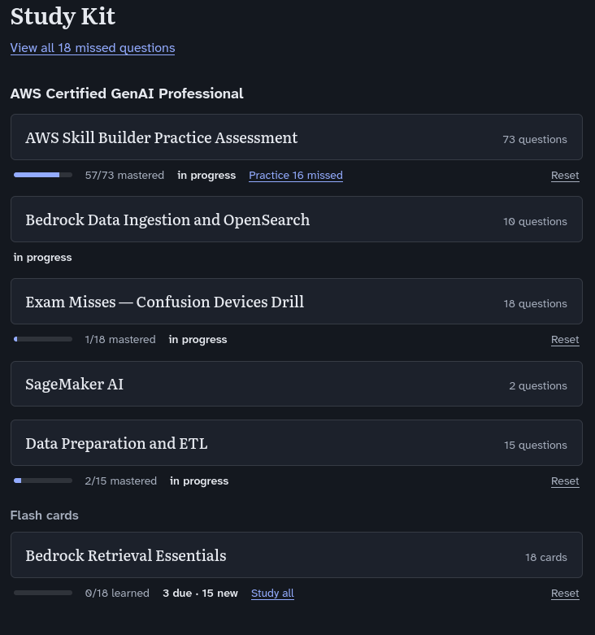

# Study Kit

A browser based study app that turns Markdown files into practice
tests and spaced-repetition flash cards. It was built for AWS certification
prep, but a deck can cover any subject: write questions or cards in plain
Markdown, for example in your notes app, and study them here.



## Features

- **Quizzes**: multiple-choice questions, one at
  a time, with immediate feedback, an explanation, and reference links. Each
  run ends with a score and a review of what you missed.
- **Practice what you missed**: rerun only the questions whose most recent answer was wrong.
- **Missed-question log**: every question you've ever missed, across all
  decks, with the answers you gave. Filter it by deck and export it as
  Markdown or JSON, for example to ask an AI assistant for more practice
  questions on your weak spots.
- **Flash cards with spaced repetition**: reveal the answer, rate how well
  you remembered it, and the app schedules the card's next review (using
  the [FSRS](https://github.com/open-spaced-repetition/ts-fsrs) algorithm).
  Cards you know come back less often; cards you miss come back sooner.

## Quick start

You need [Node.js](https://nodejs.org/) 24 or later.

```sh
npm install
npm run dev
```

Open http://localhost:5173. Until you add your own decks, the app shows the
two example decks in [`examples/decks/`](examples/decks/).

## Adding your decks

The app reads every `.md` file under a `content/` folder in the project root.
Subfolders are fine. `content/` is excluded from git, so your decks stay
private. Either:

- **Create the folder** and put deck files in it:

  ```sh
  mkdir content
  cp examples/decks/*.md content/
  ```

- **Or link it to a folder you already keep notes in**, such as an Obsidian
  vault, so you can edit decks where you write everything else:

  ```sh
  ln -s /path/to/your/notes/StudyKitDecks content
  ```

Restart `npm run dev` after creating the folder or link. After that, edits to
deck files show up when you reload the page.

## Writing decks

A deck is a Markdown file with a small YAML header. Each `###` heading starts a question.

```markdown
---
title: Bedrock Data Ingestion and OpenSearch
cert: AWS Certified GenAI Professional
tags: [bedrock, opensearch, rag, knowledge-base]
---

### A logistics company runs a live chat support app. Every time a chat session ends, the app generates a transcript in memory as a plain-text string — the transcripts are never written to any file or S3 bucket. The company wants each transcript to become queryable in its Bedrock knowledge base within a couple of minutes of the chat ending, without writing the transcript to S3 first and without triggering a full data-source sync for every single transcript.

Which solution will meet these requirements?

- [ ] Create an Amazon S3 data source for the knowledge base. Call the `IngestKnowledgeBaseDocuments` API, passing the transcript text directly as inline document content in the request.
- [x] Create a Custom data source for the knowledge base. Call the `IngestKnowledgeBaseDocuments` API, passing the transcript text directly as inline document content in the request.
- [ ] Create an Amazon S3 data source for the knowledge base. Write each transcript to the configured S3 bucket, then run a full sync (`StartIngestionJob`) on the data source every time a new transcript arrives.
- [ ] Create a Custom data source for the knowledge base. Write each transcript to an S3 bucket, then call `IngestKnowledgeBaseDocuments`, specifying the transcript's S3 location as the document content.

> A Custom data source supports both an inline document definition and an S3 location. Calling `IngestKnowledgeBaseDocuments` with the transcript text supplied inline lets the company add the document directly into the knowledge base and vector store within minutes, without ever writing the transcript to S3 and without running a full `StartIngestionJob` sync of the entire data source. An S3 data source, by contrast, only supports specifying a document by its S3 location — inline content is not a supported option for that data source type.
```

Checked items (`[x]`) are the correct answers; check more than one for a
"select all that apply" question. The blockquote is the explanation shown
after you answer. `cert` groups decks in the deck picker.

For flash cards, add `kind: flashcards` to the header. Each heading is then a
card's front, and the Markdown under it is the back:

```markdown
---
title: RAG Basics
kind: flashcards
---

### Which vector index answers this requirement?

> Similarity search combined with relational joins, filters, and transactions on the same data, in one query.

**Aurora PostgreSQL with pgvector**, which adds a vector column type and similarity operators to SQL.
```

See [docs/deck-format.md](docs/deck-format.md) for the full format, including
reference links, code snippets on the front of a card, and how editing a deck
affects your saved progress.

## Studying flash cards

Click a card deck to review the cards that are due, plus a daily allowance of
new cards (20 by default). After revealing each answer, rate how well you
remembered it:

| Rating | Meaning |
|---|---|
| **Again** | You forgot it. It comes back a few cards later in this session. |
| **Hard** | You remembered it, with difficulty. |
| **Good** | You remembered it. |
| **Easy** | You knew it instantly. |

During a review, each button shows when you'd see the card next. **Study all** runs through
every card in the deck without changing its schedule, for last-minute review.

| Key | Action |
|---|---|
| Space or Enter | Reveal the answer; once revealed, rate **Good** |
| 1 / 2 / 3 / 4 | Rate Again / Hard / Good / Easy |
| U | Undo the last rating |
| Esc | Back to the deck list |

## Where your progress is stored

Quiz history, missed-question log, and flash card schedules are saved in
your browser's local storage.
